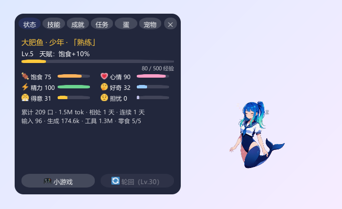
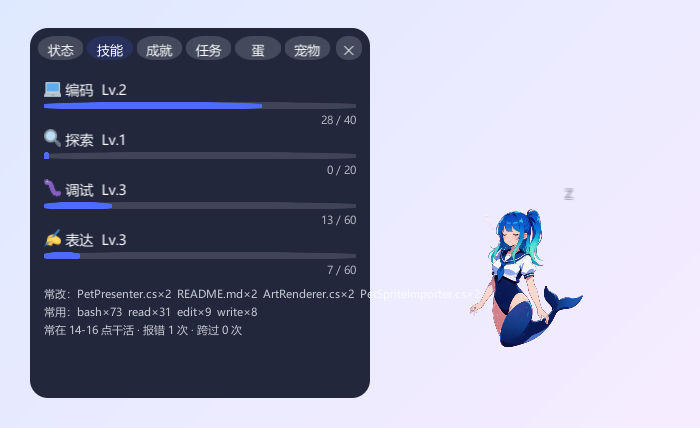
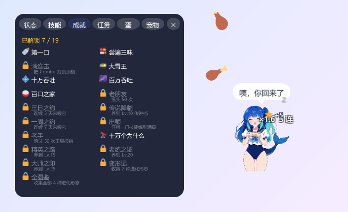
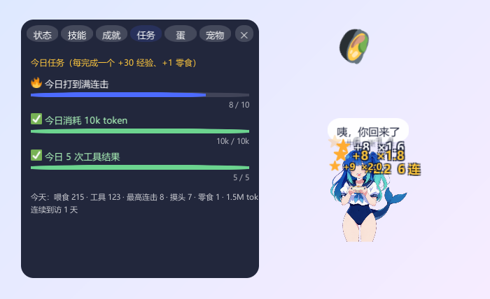
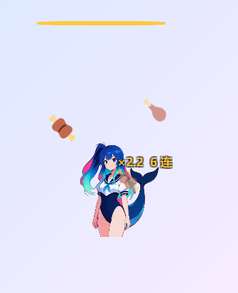

<div align="center">

# deepseek-pet · 桌宠

**一只住在 Windows 桌面右下角的鲸鱼娘，吃的是你的 AI 编程助手干活时烧掉的 token。**

支持 Claude Code · Codex · DeepSeek Harness



</div>

你发一句话、模型回一段、工具跑完一次，它都吃一口。

> 非官方同人项目，与 DeepSeek、Anthropic、OpenAI 均无关。

## 玩法

- **喂食**：输入 🥕、生成 🐟、工具结果 🍖，token 越多份量越大；连着来叠连击，顶满开暴食。
- **成长**：用什么工具长什么技能，Lv.10 后按领先的技能进化成代码猫、探索狐、调试虫或文鸟。
- **陪伴**：会饿、会困、会睡，偶尔说句话提醒你。
- **收集**：成就、每日任务、蛋、多宠物、小游戏，都在宠物面板里。

<p>


</p>
<p>


</p>

## 操作

| 怎么做 | 发生什么 |
|---|---|
| 鼠标放到它身上 | 脚下出现状态条（饱食 / 心情 / 精力 / 零食） |
| 单击 | 摸头 |
| 按住拖动 | 换位置，下次打开还在原地 |
| 右键 | 菜单：喂零食、摸摸头、宠物面板、连接 Claude Code、调试面板、退出 |
| 托盘里的 🐳 | 显示 / 隐藏桌宠、宠物面板、退出（桌宠被挡住或藏起来时从这里找回来） |

窗口只有宠物那么大，透明、始终置顶、不占任务栏；鼠标不在它身上时点击直接穿透到下面的窗口，点它也不会抢走你编辑器的输入焦点。

## 安装

Windows 10 / 11（64 位）。

1. 到 Releases 下载 `deepseek-pet-desktop-<版本>-win64.zip`，解压到任意文件夹。
2. 双击 **`连接AI助手.cmd`**。

就这些。它会自动接上电脑里装了的 Claude Code、Codex 和 [DeepSeek Harness](https://github.com/deepseek-ai/deepseek-harness)，然后把桌宠启动起来；没装的会跳过，以后装了再点一次就行。Claude Code 要新开会话才生效，dsh 要重启才生效。

以后直接双击 `DeepseekPet.exe`。不想用了就双击 `断开AI助手.cmd`。

### 自己打包

需要 [Unity](https://unity.com/download) 2022.3.15f1，然后：

```
powershell -ExecutionPolicy Bypass -File scriptspackage.ps1
```

产物在 `dist/` 下，就是 Releases 里那个 zip。

## 许可

代码以 [MIT](LICENSE) 许可发布。

- 鲸鱼娘立绘和四种动物形态是 AI 生成的同人形象，随项目一同提供。
- 彩色 emoji 来自 [Twemoji](https://github.com/jdecked/twemoji)，以 CC-BY 4.0 授权。
- 其余第三方资源见 [THIRD_PARTY.md](THIRD_PARTY.md)。

「DeepSeek」「DeepSeek Harness」是深度求索公司的商标，「Claude」是 Anthropic 的商标，「Codex」是 OpenAI 的商标。本项目只是兼容它们，不代表任何官方背书。
